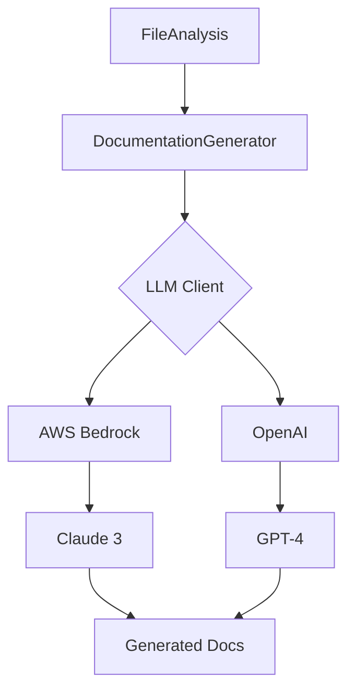

# 📋 PLAN DE IMPLEMENTACIÓN - FASE 2: Modernización

**Documento de planificación técnica detallada**

---

## 📊 Resumen Ejecutivo

**Fase:** 2 - Modernización  
**Duración Estimada:** 4 semanas (20 días hábiles)  
**Equipo Requerido:** 2-3 desarrolladores  
**Estado:** 📋 EN PLANIFICACIÓN  
**Fecha Inicio Planeada:** TBD  
**Prerrequisito:** ✅ Fase 1 completada

### Objetivos Principales

1. 🌐 **API REST funcional** con FastAPI
2. 🔤 **Soporte multi-lenguaje** (Java, JavaScript, TypeScript)
3. 🤖 **Generación de documentación** con IA (LLM)
4. 🔗 **Integraciones externas** (Confluence, Jira Assets)
5. ⚡ **Sistema de cache** con Redis

---

## 🏗️ Arquitectura Propuesta

### Estructura de Directorios (Nueva)

```
doc-as-codePRO/
├── src/
│   ├── api/                    # 🆕 API REST con FastAPI
│   │   ├── __init__.py
│   │   ├── main.py            # FastAPI app
│   │   ├── routes/
│   │   │   ├── __init__.py
│   │   │   ├── analysis.py    # Rutas de análisis
│   │   │   ├── health.py      # Health checks
│   │   │   └── metrics.py     # Métricas Prometheus
│   │   ├── schemas/           # Pydantic schemas
│   │   │   ├── __init__.py
│   │   │   ├── requests.py
│   │   │   └── responses.py
│   │   └── dependencies.py    # Dependency injection
│   │
│   ├── core/
│   │   ├── analyzers/
│   │   │   ├── base.py        # Existente
│   │   │   ├── factory.py     # Existente
│   │   │   ├── python_analyzer.py  # Existente
│   │   │   ├── java_analyzer.py    # 🆕 Nuevo
│   │   │   ├── javascript_analyzer.py  # 🆕 Nuevo
│   │   │   └── typescript_analyzer.py  # 🆕 Nuevo
│   │   │
│   │   ├── generators/        # 🆕 Generadores de docs
│   │   │   ├── __init__.py
│   │   │   ├── base.py
│   │   │   ├── readme_generator.py
│   │   │   ├── code_doc_generator.py
│   │   │   └── api_doc_generator.py
│   │   │
│   │   └── llm/               # 🆕 Integración LLM
│   │       ├── __init__.py
│   │       ├── base.py
│   │       ├── bedrock_client.py
│   │       └── openai_client.py
│   │
│   ├── integrations/          # 🆕 Integraciones externas
│   │   ├── __init__.py
│   │   ├── confluence.py
│   │   └── jira_assets.py
│   │
│   ├── cache/                 # 🆕 Cache layer
│   │   ├── __init__.py
│   │   ├── redis_cache.py
│   │   └── cache_keys.py
│   │
│   ├── config/                # Existente (actualizar)
│   ├── models/                # Existente (expandir)
│   └── utils/                 # Existente
│
├── tests/
│   ├── unit/                  # Existente
│   ├── integration/           # 🆕 Tests de integración
│   │   ├── test_api.py
│   │   ├── test_analyzers.py
│   │   └── test_generators.py
│   └── fixtures/              # 🆕 Fixtures compartidas
│
└── examples/                  # 🆕 Ejemplos de uso
    ├── sample_java/
    ├── sample_js/
    └── sample_ts/
```

---

## 🎯 Componente 1: API REST con FastAPI

### Diseño de Endpoints

#### 1. POST `/api/v1/analyze`
**Propósito:** Iniciar análisis de repositorio

**Request:**
```json
{
  "repository_url": "https://github.com/user/repo",
  "branch": "main",
  "languages": ["python", "java"],
  "options": {
    "generate_docs": true,
    "publish_confluence": false,
    "cache_enabled": true
  }
}
```

**Response (202 Accepted):**
```json
{
  "analysis_id": "uuid-here",
  "status": "pending",
  "created_at": "2025-02-05T10:00:00Z",
  "estimated_completion": "2025-02-05T10:05:00Z"
}
```

#### 2. GET `/api/v1/analysis/{analysis_id}`
**Propósito:** Obtener resultado de análisis

**Response (200 OK - Completado):**
```json
{
  "analysis_id": "uuid-here",
  "status": "completed",
  "repository_name": "my-repo",
  "total_files": 150,
  "total_lines": 50000,
  "languages": ["python", "java"],
  "components": {
    "api": 15,
    "database": 10,
    "utility": 125
  },
  "generated_docs": {
    "readme": "https://...",
    "api_docs": "https://..."
  },
  "created_at": "2025-02-05T10:00:00Z",
  "completed_at": "2025-02-05T10:04:30Z"
}
```

**Response (202 Accepted - En progreso):**
```json
{
  "analysis_id": "uuid-here",
  "status": "processing",
  "progress": 65,
  "current_step": "Analyzing Java files",
  "files_processed": 98,
  "total_files": 150
}
```

#### 3. GET `/health`
**Propósito:** Health check

**Response:**
```json
{
  "status": "healthy",
  "version": "3.0.0",
  "dependencies": {
    "redis": "connected",
    "llm": "available"
  }
}
```

#### 4. GET `/metrics`
**Propósito:** Métricas Prometheus

**Response:** (Formato Prometheus)
```
# HELP analysis_total Total number of analyses
# TYPE analysis_total counter
analysis_total 1234
```

### Schemas Pydantic

```python
# src/api/schemas/requests.py
from pydantic import BaseModel, HttpUrl, Field
from typing import List, Optional

class AnalysisOptions(BaseModel):
    generate_docs: bool = Field(default=True)
    publish_confluence: bool = Field(default=False)
    cache_enabled: bool = Field(default=True)
    max_file_size_kb: int = Field(default=500)

class AnalysisRequest(BaseModel):
    repository_url: Optional[HttpUrl] = None
    local_path: Optional[str] = None
    branch: str = Field(default="main")
    languages: Optional[List[str]] = None
    options: AnalysisOptions = Field(default_factory=AnalysisOptions)
    
    class Config:
        json_schema_extra = {
            "example": {
                "repository_url": "https://github.com/user/repo",
                "branch": "main",
                "languages": ["python", "java"]
            }
        }
```

```python
# src/api/schemas/responses.py
from pydantic import BaseModel
from enum import Enum
from datetime import datetime
from typing import Dict, List, Optional

class AnalysisStatus(str, Enum):
    PENDING = "pending"
    PROCESSING = "processing"
    COMPLETED = "completed"
    FAILED = "failed"

class AnalysisResponse(BaseModel):
    analysis_id: str
    status: AnalysisStatus
    repository_name: Optional[str] = None
    total_files: Optional[int] = None
    total_lines: Optional[int] = None
    languages: Optional[List[str]] = None
    components: Optional[Dict[str, int]] = None
    progress: Optional[int] = None
    created_at: datetime
    completed_at: Optional[datetime] = None
```

### Implementación FastAPI

```python
# src/api/main.py
from fastapi import FastAPI
from fastapi.middleware.cors import CORSMiddleware
from prometheus_fastapi_instrumentator import Instrumentator

from src.api.routes import analysis, health
from src.config.settings import get_settings

settings = get_settings()

app = FastAPI(
    title="Doc-as-Code API",
    description="API para análisis de código y generación de documentación",
    version="3.0.0",
    docs_url="/docs",
    redoc_url="/redoc"
)

# CORS
app.add_middleware(
    CORSMiddleware,
    allow_origins=settings.api.cors_origins,
    allow_credentials=True,
    allow_methods=["*"],
    allow_headers=["*"],
)

# Prometheus metrics
Instrumentator().instrument(app).expose(app)

# Routes
app.include_router(analysis.router, prefix="/api/v1", tags=["Analysis"])
app.include_router(health.router, prefix="", tags=["Health"])

@app.on_event("startup")
async def startup_event():
    """Initialize services on startup"""
    # TODO: Initialize Redis, check LLM connection, etc.
    pass

@app.on_event("shutdown")
async def shutdown_event():
    """Cleanup on shutdown"""
    # TODO: Close connections
    pass
```

### Decisiones Técnicas API

| Decisión | Opción Elegida | Razón |
|----------|----------------|-------|
| **Framework** | FastAPI | Async, rápido, auto-docs, Pydantic nativo |
| **Versioning** | Path versioning (`/api/v1/`) | Estándar, fácil mantener múltiples versiones |
| **Autenticación** | API Key (Fase 2), JWT (Fase 3+) | Simple para empezar, escalable después |
| **Rate Limiting** | Slowapi | Integración fácil con FastAPI |
| **Documentación** | Swagger UI + ReDoc | Incluido en FastAPI |
| **CORS** | CORSMiddleware | Necesario para frontends |

---

## 🔤 Componente 2: Analizadores Multi-lenguaje

### Parsers Seleccionados

| Lenguaje | Parser/Librería | Razón |
|----------|-----------------|-------|
| **Java** | `javalang` | Pure Python, sin dependencias externas, AST completo |
| **JavaScript** | `esprima` | Estándar ECMAScript, bien mantenido |
| **TypeScript** | `tree-sitter-typescript` | Parser robusto usado por GitHub |

### JavaAnalyzer - Diseño

```python
# src/core/analyzers/java_analyzer.py
from pathlib import Path
from typing import List
import javalang

from src.core.analyzers.base import CodeAnalyzer
from src.models.domain import FileAnalysis, LanguageType

class JavaAnalyzer(CodeAnalyzer):
    """Analizador para archivos Java."""
    
    @property
    def supported_languages(self) -> List[LanguageType]:
        return [LanguageType.JAVA]
    
    def can_analyze(self, file_path: Path) -> bool:
        return file_path.suffix.lower() == '.java'
    
    def analyze_file(self, file_path: Path) -> FileAnalysis:
        """Analiza un archivo Java."""
        content = self._read_file_content(file_path)
        
        try:
            # Parse Java code
            tree = javalang.parse.parse(content)
            
            # Extract information
            classes = self._extract_classes(tree)
            methods = self._extract_methods(tree)
            imports = self._extract_imports(tree)
            annotations = self._extract_annotations(tree)
            endpoints = self._detect_spring_endpoints(tree)
            database_entities = self._detect_jpa_entities(tree)
            
            return FileAnalysis(
                file_path=str(file_path),
                language=LanguageType.JAVA,
                lines=len(content.splitlines()),
                classes=classes,
                functions=methods,
                imports=imports,
                endpoints=endpoints,
                database_calls=database_entities,
                complexity=self._calculate_complexity(tree)
            )
        except javalang.parser.JavaSyntaxError as e:
            # Handle syntax errors gracefully
            return FileAnalysis(
                file_path=str(file_path),
                language=LanguageType.JAVA,
                lines=len(content.splitlines()),
                classes=[],
                functions=[],
                imports=[],
                error=f"Syntax error: {str(e)}"
            )
    
    def _detect_spring_endpoints(self, tree) -> List[dict]:
        """Detecta endpoints de Spring Boot."""
        endpoints = []
        
        for path, node in tree:
            if isinstance(node, javalang.tree.MethodDeclaration):
                # Check for REST annotations
                if node.annotations:
                    for annotation in node.annotations:
                        if annotation.name in ['GetMapping', 'PostMapping', 
                                              'PutMapping', 'DeleteMapping',
                                              'RequestMapping']:
                            endpoints.append({
                                'method': node.name,
                                'annotation': annotation.name,
                                'path': self._extract_mapping_path(annotation)
                            })
        
        return endpoints
    
    def _detect_jpa_entities(self, tree) -> List[str]:
        """Detecta entidades JPA."""
        entities = []
        
        for path, node in tree:
            if isinstance(node, javalang.tree.ClassDeclaration):
                if node.annotations:
                    for annotation in node.annotations:
                        if annotation.name in ['Entity', 'Table']:
                            entities.append(node.name)
        
        return entities
```

### JavaScriptAnalyzer - Diseño

```python
# src/core/analyzers/javascript_analyzer.py
from pathlib import Path
from typing import List
import esprima

from src.core.analyzers.base import CodeAnalyzer
from src.models.domain import FileAnalysis, LanguageType

class JavaScriptAnalyzer(CodeAnalyzer):
    """Analizador para archivos JavaScript."""
    
    @property
    def supported_languages(self) -> List[LanguageType]:
        return [LanguageType.JAVASCRIPT]
    
    def can_analyze(self, file_path: Path) -> bool:
        return file_path.suffix.lower() in ['.js', '.mjs', '.cjs']
    
    def analyze_file(self, file_path: Path) -> FileAnalysis:
        """Analiza un archivo JavaScript."""
        content = self._read_file_content(file_path)
        
        try:
            # Parse JavaScript code
            tree = esprima.parseModule(content, {'loc': True})
            
            # Extract information
            functions = self._extract_functions(tree)
            classes = self._extract_classes(tree)
            imports = self._extract_imports(tree)
            exports = self._extract_exports(tree)
            endpoints = self._detect_express_routes(tree)
            
            return FileAnalysis(
                file_path=str(file_path),
                language=LanguageType.JAVASCRIPT,
                lines=len(content.splitlines()),
                classes=classes,
                functions=functions,
                imports=imports,
                endpoints=endpoints,
                complexity=self._calculate_complexity(tree)
            )
        except esprima.Error as e:
            return FileAnalysis(
                file_path=str(file_path),
                language=LanguageType.JAVASCRIPT,
                lines=len(content.splitlines()),
                error=f"Parse error: {str(e)}"
            )
    
    def _detect_express_routes(self, tree) -> List[dict]:
        """Detecta rutas de Express.js."""
        # Implementation to detect app.get(), app.post(), etc.
        pass
```

### Actualización de domain.py

```python
# src/models/domain.py - Agregar nuevos lenguajes
class LanguageType(str, Enum):
    PYTHON = "python"
    JAVA = "java"           # 🆕
    JAVASCRIPT = "javascript"  # 🆕
    TYPESCRIPT = "typescript"  # 🆕
    GO = "go"               # Futuro
    RUST = "rust"           # Futuro
```

---

## 🤖 Componente 3: Generación de Documentación con IA

### Arquitectura LLM



### LLM Client Base

```python
# src/core/llm/base.py
from abc import ABC, abstractmethod
from typing import Dict, List

class LLMClient(ABC):
    """Interfaz base para clientes LLM."""
    
    @abstractmethod
    async def generate_text(
        self,
        prompt: str,
        max_tokens: int = 1000,
        temperature: float = 0.7
    ) -> str:
        """Genera texto usando el LLM."""
        pass
    
    @abstractmethod
    async def generate_documentation(
        self,
        code: str,
        context: Dict[str, any]
    ) -> str:
        """Genera documentación para código."""
        pass
```

### AWS Bedrock Client

```python
# src/core/llm/bedrock_client.py
import boto3
import json
from typing import Dict

from src.core.llm.base import LLMClient
from src.config.settings import get_settings

class BedrockClient(LLMClient):
    """Cliente para AWS Bedrock (Claude)."""
    
    def __init__(self):
        settings = get_settings()
        self.client = boto3.client(
            'bedrock-runtime',
            region_name=settings.bedrock.region,
            aws_access_key_id=settings.bedrock.access_key_id,
            aws_secret_access_key=settings.bedrock.secret_access_key
        )
        self.model_id = settings.bedrock.model_id
    
    async def generate_text(
        self,
        prompt: str,
        max_tokens: int = 1000,
        temperature: float = 0.7
    ) -> str:
        """Genera texto con Claude."""
        
        body = json.dumps({
            "anthropic_version": "bedrock-2023-05-31",
            "max_tokens": max_tokens,
            "messages": [
                {
                    "role": "user",
                    "content": prompt
                }
            ],
            "temperature": temperature
        })
        
        response = self.client.invoke_model(
            modelId=self.model_id,
            body=body
        )
        
        response_body = json.loads(response['body'].read())
        return response_body['content'][0]['text']
```

### README Generator

```python
# src/core/generators/readme_generator.py
from typing import Dict
from src.core.llm.base import LLMClient
from src.models.domain import ProjectAnalysis

class ReadmeGenerator:
    """Genera README.md automáticamente usando IA."""
    
    def __init__(self, llm_client: LLMClient):
        self.llm = llm_client
    
    async def generate(self, analysis: ProjectAnalysis) -> str:
        """Genera README completo para un proyecto."""
        
        prompt = self._build_prompt(analysis)
        readme_content = await self.llm.generate_text(
            prompt=prompt,
            max_tokens=2000,
            temperature=0.7
        )
        
        return readme_content
    
    def _build_prompt(self, analysis: ProjectAnalysis) -> str:
        """Construye el prompt para el LLM."""
        
        return f"""
Eres un experto en documentación técnica. Genera un README.md profesional 
para el siguiente proyecto:

**Nombre del proyecto:** {analysis.repository_name}
**Lenguajes:** {', '.join(analysis.languages)}
**Total de archivos:** {analysis.total_files}
**Total de líneas:** {analysis.total_lines}
**Componentes detectados:**
{self._format_components(analysis.components)}

**Archivos principales:**
{self._format_main_files(analysis.files[:10])}

Genera un README que incluya:
1. Título y descripción breve del proyecto
2. Tabla con stack tecnológico detectado
3. Estructura del proyecto
4. Instrucciones de instalación (generales)
5. Uso básico
6. Arquitectura y componentes principales
7. Licencia

Usa formato Markdown profesional con emojis apropiados.
"""

    def _format_components(self, components: Dict) -> str:
        """Formatea los componentes para el prompt."""
        result = []
        for comp_type, files in components.items():
            if files:
                result.append(f"- {comp_type}: {len(files)} archivos")
        return "\n".join(result)
```

### Prompts Optimizados

```python
# src/core/generators/prompts.py

README_PROMPT_TEMPLATE = """
Eres un experto en documentación técnica. Genera un README.md profesional...
"""

CODE_DOC_PROMPT_TEMPLATE = """
Eres un experto desarrollador. Documenta la siguiente función/clase:

```{language}
{code}
```

Genera:
1. Docstring completo con descripción
2. Parámetros y tipos
3. Valor de retorno
4. Ejemplos de uso
5. Notas importantes o edge cases
"""

API_DOC_PROMPT_TEMPLATE = """
Documenta el siguiente endpoint REST API:

**Método:** {method}
**Ruta:** {path}
**Código:**
```{language}
{code}
```

Genera documentación que incluya:
1. Descripción del endpoint
2. Parámetros (query, path, body)
3. Response schema
4. Ejemplos de request/response
5. Códigos de error posibles
"""
```

---

## 🔗 Componente 4: Integraciones Externas

### Confluence Publisher

```python
# src/integrations/confluence.py
from atlassian import Confluence
from typing import Optional
from src.config.settings import get_settings
from src.utils.logging import get_logger

logger = get_logger(__name__)

class ConfluencePublisher:
    """Publica documentación en Confluence."""
    
    def __init__(self):
        settings = get_settings()
        self.client = Confluence(
            url=settings.confluence.base_url,
            username=settings.confluence.email,
            password=settings.confluence.api_token,
            verify_ssl=settings.confluence.verify_ssl
        )
    
    def publish_page(
        self,
        space_key: str,
        title: str,
        content: str,
        parent_id: Optional[str] = None
    ) -> dict:
        """Crea o actualiza una página en Confluence."""
        
        try:
            # Check if page exists
            existing_page = self.client.get_page_by_title(
                space=space_key,
                title=title
            )
            
            if existing_page:
                # Update existing page
                logger.info(
                    "updating_confluence_page",
                    page_id=existing_page['id'],
                    title=title
                )
                return self.client.update_page(
                    page_id=existing_page['id'],
                    title=title,
                    body=content
                )
            else:
                # Create new page
                logger.info(
                    "creating_confluence_page",
                    title=title,
                    space=space_key
                )
                return self.client.create_page(
                    space=space_key,
                    title=title,
                    body=content,
                    parent_id=parent_id
                )
        except Exception as e:
            logger.error(
                "confluence_publish_failed",
                error=str(e),
                title=title
            )
            raise
    
    def upload_attachment(
        self,
        page_id: str,
        file_path: str,
        filename: str
    ) -> dict:
        """Sube un archivo adjunto a una página."""
        return self.client.attach_file(
            filename=file_path,
            name=filename,
            page_id=page_id
        )
```

### Jira Assets Client

```python
# src/integrations/jira_assets.py
import requests
from typing import Dict, List, Optional
from src.config.settings import get_settings
from src.utils.logging import get_logger

logger = get_logger(__name__)

class JiraAssetsClient:
    """Cliente para Jira Assets (inventario técnico)."""
    
    def __init__(self):
        settings = get_settings()
        self.base_url = settings.jira.base_url
        self.auth = (settings.jira.email, settings.jira.api_token)
        self.workspace_id = settings.jira.workspace_id
    
    def register_service(
        self,
        service_name: str,
        metadata: Dict
    ) -> dict:
        """Registra un servicio en Jira Assets."""
        
        object_data = {
            "objectSchemaId": self.workspace_id,
            "objectTypeName": "Service",
            "attributes": [
                {"name": "Name", "value": service_name},
                {"name": "Language", "value": metadata.get("language")},
                {"name": "Lines of Code", "value": metadata.get("total_lines")},
                {"name": "Components", "value": ", ".join(metadata.get("components", []))}
            ]
        }
        
        response = requests.post(
            f"{self.base_url}/rest/insight/1.0/object/create",
            json=object_data,
            auth=self.auth
        )
        
        response.raise_for_status()
        return response.json()
```

---

## ⚡ Componente 5: Sistema de Cache con Redis

### Redis Cache Service

```python
# src/cache/redis_cache.py
import redis
import json
from typing import Optional, Any
from datetime import timedelta

from src.config.settings import get_settings
from src.utils.logging import get_logger

logger = get_logger(__name__)

class RedisCache:
    """Servicio de cache con Redis."""
    
    def __init__(self):
        settings = get_settings()
        self.client = redis.Redis(
            host=settings.redis.host,
            port=settings.redis.port,
            password=settings.redis.password,
            db=settings.redis.db,
            decode_responses=True
        )
        self.default_ttl = settings.redis.default_ttl
    
    def get(self, key: str) -> Optional[Any]:
        """Obtiene valor del cache."""
        try:
            value = self.client.get(key)
            if value:
                logger.debug("cache_hit", key=key)
                return json.loads(value)
            logger.debug("cache_miss", key=key)
            return None
        except Exception as e:
            logger.error("cache_get_error", key=key, error=str(e))
            return None
    
    def set(
        self,
        key: str,
        value: Any,
        ttl: Optional[int] = None
    ) -> bool:
        """Guarda valor en cache."""
        try:
            ttl = ttl or self.default_ttl
            serialized = json.dumps(value, default=str)
            self.client.setex(
                key,
                timedelta(seconds=ttl),
                serialized
            )
            logger.debug("cache_set", key=key, ttl=ttl)
            return True
        except Exception as e:
            logger.error("cache_set_error", key=key, error=str(e))
            return False
    
    def delete(self, key: str) -> bool:
        """Elimina valor del cache."""
        try:
            self.client.delete(key)
            logger.debug("cache_delete", key=key)
            return True
        except Exception as e:
            logger.error("cache_delete_error", key=key, error=str(e))
            return False
    
    def invalidate_pattern(self, pattern: str) -> int:
        """Invalida todas las keys que coincidan con el patrón."""
        try:
            keys = self.client.keys(pattern)
            if keys:
                deleted = self.client.delete(*keys)
                logger.info("cache_invalidated", pattern=pattern, count=deleted)
                return deleted
            return 0
        except Exception as e:
            logger.error("cache_invalidate_error", pattern=pattern, error=str(e))
            return 0
```

### Cache Keys Strategy

```python
# src/cache/cache_keys.py

def analysis_cache_key(repo_url: str, branch: str) -> str:
    """Genera key para cache de análisis."""
    return f"analysis:{repo_url}:{branch}"

def file_cache_key(file_path: str, commit_hash: str) -> str:
    """Genera key para cache de archivo individual."""
    return f"file:{commit_hash}:{file_path}"

def docs_cache_key(repo_url: str, doc_type: str) -> str:
    """Genera key para documentación generada."""
    return f"docs:{repo_url}:{doc_type}"
```

---

## 📦 Dependencias Nuevas

### Agregar a pyproject.toml

```toml
[tool.poetry.dependencies]
# Existing dependencies...

# API REST
fastapi = "^0.109.0"
uvicorn = {extras = ["standard"], version = "^0.27.0"}
python-multipart = "^0.0.6"
prometheus-fastapi-instrumentator = "^6.1.0"

# Parsers multi-lenguaje
javalang = "^0.13.0"         # Java parser
esprima = "^4.0.1"           # JavaScript parser
tree-sitter = "^0.20.4"      # TypeScript parser
tree-sitter-typescript = "^0.20.3"

# LLM clients
openai = "^1.10.0"           # Ya existe
boto3 = "^1.34.0"            # Ya existe

# Integraciones
atlassian-python-api = "^3.41.0"  # Confluence/Jira
requests = "^2.31.0"         # Ya existe

# Cache
redis = "^5.0.1"             # Ya existe

[tool.poetry.group.dev.dependencies]
# Testing
httpx = "^0.26.0"            # Para tests de FastAPI
faker = "^22.0.0"            # Ya existe
```

---

## 🧪 Estrategia de Testing

### Tests de Integración para API

```python
# tests/integration/test_api.py
import pytest
from fastapi.testclient import TestClient

from src.api.main import app

client = TestClient(app)

def test_health_endpoint():
    """Test del endpoint /health."""
    response = client.get("/health")
    assert response.status_code == 200
    assert response.json()["status"] == "healthy"

def test_analyze_endpoint_sync():
    """Test del endpoint POST /api/v1/analyze."""
    payload = {
        "local_path": "./tests/fixtures/sample_python",
        "languages": ["python"]
    }
    response = client.post("/api/v1/analyze", json=payload)
    assert response.status_code == 202
    assert "analysis_id" in response.json()

@pytest.mark.asyncio
async def test_get_analysis_result():
    """Test del endpoint GET /api/v1/analysis/{id}."""
    # First create an analysis
    # Then retrieve it
    pass
```

### Tests para Analizadores

```python
# tests/unit/test_java_analyzer.py
import pytest
from pathlib import Path

from src.core.analyzers.java_analyzer import JavaAnalyzer

@pytest.fixture
def java_analyzer():
    return JavaAnalyzer()

@pytest.fixture
def sample_java_file(tmp_path):
    """Crea un archivo Java de ejemplo."""
    java_code = """
    package com.example;
    
    import org.springframework.web.bind.annotation.*;
    
    @RestController
    @RequestMapping("/api/users")
    public class UserController {
        
        @GetMapping("/{id}")
        public User getUser(@PathVariable Long id) {
            return userService.findById(id);
        }
    }
    """
    file_path = tmp_path / "UserController.java"
    file_path.write_text(java_code)
    return file_path

def test_java_analyzer_can_analyze(java_analyzer, sample_java_file):
    """Test que JavaAnalyzer detecta archivos .java."""
    assert java_analyzer.can_analyze(sample_java_file)

def test_java_analyzer_extracts_classes(java_analyzer, sample_java_file):
    """Test extracción de clases."""
    analysis = java_analyzer.analyze_file(sample_java_file)
    assert "UserController" in analysis.classes

def test_java_analyzer_detects_spring_endpoints(java_analyzer, sample_java_file):
    """Test detección de endpoints Spring."""
    analysis = java_analyzer.analyze_file(sample_java_file)
    assert len(analysis.endpoints) > 0
    assert any(ep["annotation"] == "GetMapping" for ep in analysis.endpoints)
```

### Fixtures Compartidas

```python
# tests/fixtures/conftest.py
import pytest
from pathlib import Path

@pytest.fixture(scope="session")
def sample_projects_dir():
    """Directorio con proyectos de ejemplo."""
    return Path(__file__).parent / "sample_projects"

@pytest.fixture
def sample_python_project(sample_projects_dir):
    return sample_projects_dir / "python_app"

@pytest.fixture
def sample_java_project(sample_projects_dir):
    return sample_projects_dir / "java_app"
```

---

## 📅 Timeline Detallado

### Semana 1: Setup y API Básica
**Días 1-2: Setup de infraestructura**
- [ ] Agregar dependencias a poetry (FastAPI, parsers, etc.)
- [ ] Crear estructura de directorios
- [ ] Configurar settings para nuevos componentes
- [ ] Setup de tests de integración

**Días 3-5: API REST básica**
- [ ] Implementar FastAPI app
- [ ] Crear schemas Pydantic (requests/responses)
- [ ] Implementar endpoint POST /analyze
- [ ] Implementar endpoint GET /analysis/{id}
- [ ] Implementar health check
- [ ] Tests de integración API

### Semana 2: Analizadores Multi-lenguaje
**Días 6-7: Java Analyzer**
- [ ] Implementar JavaAnalyzer base
- [ ] Extracción de clases, métodos, imports
- [ ] Detección de Spring endpoints
- [ ] Detección de entidades JPA
- [ ] Tests unitarios

**Días 8-9: JavaScript Analyzer**
- [ ] Implementar JavaScriptAnalyzer
- [ ] Extracción de funciones, clases
- [ ] Detección de Express routes
- [ ] Tests unitarios

**Día 10: TypeScript Analyzer**
- [ ] Implementar TypeScriptAnalyzer básico
- [ ] Tests unitarios
- [ ] Actualizar AnalyzerFactory

### Semana 3: Generación de Docs con IA
**Días 11-12: LLM Infrastructure**
- [ ] Implementar BedrockClient
- [ ] Implementar OpenAIClient (alternativa)
- [ ] Tests con mocks

**Días 13-14: Generadores**
- [ ] ReadmeGenerator
- [ ] CodeDocGenerator
- [ ] ApiDocGenerator
- [ ] Tests de generación

**Día 15: Optimización de prompts**
- [ ] Refinar prompts
- [ ] Validar calidad de docs generados
- [ ] Tests end-to-end

### Semana 4: Integraciones y Cache
**Días 16-17: Integraciones**
- [ ] ConfluencePublisher
- [ ] JiraAssetsClient
- [ ] Tests de integración (con mocks)

**Días 18-19: Cache con Redis**
- [ ] RedisCache service
- [ ] Integración con API endpoints
- [ ] Cache invalidation strategy
- [ ] Tests

**Día 20: Testing final y docs**
- [ ] Tests de integración completos
- [ ] Coverage report (target 80%+)
- [ ] Documentación actualizada
- [ ] README de Fase 2

---

## ⚠️ Riesgos y Mitigaciones

| Riesgo | Probabilidad | Impacto | Mitigación |
|--------|--------------|---------|------------|
| **Parsers no manejan código legacy** | Media | Alto | Tests con código real de producción, fallback graceful |
| **LLM genera docs de baja calidad** | Media | Medio | Prompts bien diseñados, revisión manual inicial |
| **Rate limits de APIs (OpenAI, etc.)** | Alta | Medio | Cache agresivo, failover a Bedrock |
| **Confluence API cambios** | Baja | Alto | Usar librería oficial, tests de integración |
| **Performance con proyectos grandes** | Media | Alto | Procesamiento paralelo, análisis incremental |

---

## ✅ Criterios de Aceptación

### API REST
- [ ] 4+ endpoints funcionando
- [ ] Documentación Swagger generada
- [ ] Tests de integración con 90%+ cobertura
- [ ] Response time \u003c 2s para análisis simple

### Analizadores
- [ ] 3+ lenguajes soportados (Python, Java, JS/TS)
- [ ] Detección de endpoints/APIs en cada lenguaje
- [ ] Tests unitarios con 85%+ cobertura
- [ ] Manejo correcto de errores de sintaxis

### Generación de Docs
- [ ] README generado automáticamente
- [ ] Calidad de docs validada manualmente
- [ ] Soporte para 2 LLM providers (Bedrock + OpenAI)
- [ ] Prompts optimizados y documentados

### Integraciones
- [ ] Publicación exitosa en Confluence
- [ ] Registro de servicios en Jira Assets
- [ ] Tests de integración con mocks

### Cache
- [ ] Redis cache funcional
- [ ] Cache hit ratio \u003e 50% en tests
- [ ] Invalidación correcta de cache

### Calidad General
- [ ] Coverage total \u003e 80%
- [ ] All tests passing
- [ ] Pre-commit hooks pasando
- [ ] Documentación actualizada

---

## 📊 Métricas de Éxito

| Métrica | Objetivo | Medición |
|---------|----------|----------|
| **Test Coverage** | \u003e 80% | pytest --cov |
| **API Response Time (p95)** | \u003c 2s | Prometheus metrics |
| **Lenguajes Soportados** | 4+ | Manual |
| **Docs Generados OK** | \u003e 90% | Validación manual muestra |
| **Cache Hit Ratio** | \u003e 50% | Redis stats |
| **Uptime API** | \u003e 99% | Health checks |

---

## 📚 Recursos y Referencias

### Documentación Técnica
- **FastAPI:** https://fastapi.tiangolo.com/
- **javalang:** https://github.com/c2nes/javalang
- **esprima:** https://esprima.org/
- **tree-sitter:** https://tree-sitter.github.io/tree-sitter/
- **AWS Bedrock:** https://docs.aws.amazon.com/bedrock/
- **OpenAI API:** https://platform.openai.com/docs
- **Atlassian API:** https://developer.atlassian.com/

### Ejemplos de Código
- Crear directorio `examples/` con proyectos de muestra
- Incluir proyectos pequeños en Java, JS, TS para testing

---

## 🎯 Próximo Paso Inmediato

**ACCIÓN RECOMENDADA:** Revisar y aprobar este plan

**Después de aprobación:**
1. Crear branch `feature/phase-2-setup`
2. Agregar dependencias a `pyproject.toml`
3. Crear estructura de directorios
4. Comenzar con API REST básica (Semana 1, Días 3-5)

---

**Documento creado:** Febrero 2025  
**Autor:** Alignet Tech Team  
**Versión:** 1.0  
**Estado:** 📋 Pendiente de aprobación
