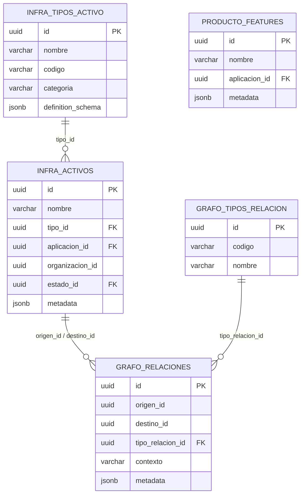

# 🏛️ Propuesta de Arquitectura de Datos — Code-Agent V1.0 (Alineada)

> **Documento de planificación** para validación con equipo técnico y DBA.
> Incorpora el paradigma de separación Físico/Lógico para soportar gran escala modular.

---

## 1. Resumen Ejecutivo

### ¿Qué necesitamos?

La iniciativa **Code-Agent V1.0** (Agente Inteligente para Mapeo de Arquitectura Técnica) va a escanear repositorios de Bitbucket y producir:

1. **Inventario de código**: Archivos físicos en disco y su contenido lógico (clases, funciones, operaciones de BD).
2. **Diagnóstico de calidad**: Score general, nivel de riesgo, métricas de complejidad, análisis OWASP.
3. **Relaciones**: Qué función invoca a cuál, qué clase accede a qué recurso AWS.

### ¿Dónde guardar esto?

Se recomienda **un modelo de alta normalización con tres tablas nuevas** en schemas dedicados, vinculadas al inventario existente de `infra.activos` via FK lógicas y al grafo existente via UUIDs.

**¿Por qué tres tablas?**
Se acordó separar la parte **"Hardware"** (el archivo físico) de la parte **"Software"** (la lógica de negocio empaquetada en funciones y clases). Esta separación permite mapear con precisión quirúrgica el Grafo de Relaciones sin crear campos JSONB masivos y difíciles de consultar.

### Alcance Fase 1 (Escaneo estático)

> En la Fase 1, el escaneo se realizará **una sola vez** como carga inicial. El diseño de las tablas ya soporta múltiples escaneos (re-escaneos) mediante el borrado y reinserción de unidades de código (ciclo de vida volátil) frente a un historial inmutable para los escaneos de calidad.

---

## 2. Arquitectura Actual (Lo que ya existe)



**Datos actuales:**
- `infra.activos`: ~413 registros (Lambdas, APIs, S3, SQS, DynamoDB, etc.)
- `infra.tipos_activo`: ~25 tipos con schemas dinámicos
- `grafo.relaciones_globales`: ~200 vínculos

---

## 3. Arquitectura Propuesta (Extensión)

### Diagrama General (Físico vs Lógico)

```text
┌─────────────────────────────────────────────────────────────────────┐
│                    SISTEMA A-ONE (Existente)                       │
│                                                                     │
│  infra.activos          grafo.relaciones         producto.features  │
│  ┌──────────┐           ┌──────────────┐         ┌──────────────┐  │
│  │ Lambdas  │◄─────────►│ REL-ARCH-02  │◄───────►│ Features     │  │
│  │ ECS      │           │ REL-INFRA    │         │ (Negocio)    │  │
│  │ S3, SQS  │           │ ...          │         └──────────────┘  │
│  └────┬─────┘           └──────┬───────┘                           │
│       │                        │                                   │
├───────┼────────────────────────┼───────────────────────────────────┤
│       │    EXTENSIÓN CODE-AGENT (Nuevo)                            │
│       │                        │                                   │
│       ▼                        ▼                                   │
│  code.unidades_fisicas  Nuevos tipos de relación                   │
│  ┌──────────────────┐   ┌──────────────────────┐                   │
│  │ Archivos .java   │──►│ REL-CODE-01 CONTIENE │                   │
│  │ Archivos .py     │   │ REL-CODE-02 INVOCA   │                   │
│  └────┬─────────────┘   │ REL-CODE-03 ACCEDE   │                   │
│       │                 │ REL-CODE-04 IMPLEMENTA                   │
│       ▼                 └──────────────────────┘                   │
│  code.unidades_logicas                                             │
│  ┌──────────────────┐                                              │
│  │ Clases / Módulos │                                              │
│  │ Funciones atómicas                                              │
│  └────┬─────────────┘                                              │
│       │                                                            │
│       ▼                                                            │
│  quality.escaneos                                                  │
│  ┌──────────────────┐                                              │
│  │ Scan #169 (oct)  │                                              │
│  │ Scan #185 (mar)  │                                              │
│  │ Score, Riesgo    │                                              │
│  │ Métricas, OWASP  │                                              │
│  └──────────────────┘                                              │
└─────────────────────────────────────────────────────────────────────┘
```

### ¿Por qué separar lo Físico de lo Lógico?

| Problema original | Solución del Diseño Híbrido Actual |
|---|---|
| **JSONB inmanejable** | Si guardamos funciones dentro de un JSONB de un archivo, no podemos buscar fácilmente con queries relacionales "todas las funciones con alta complejidad". Al tener su propia tabla (`unidades_logicas`), es SQL nativo e indexado. |
| **Pérdida de Traza en Grafo** | Si la unidad mínima es el Archivo, el grafo dirá "El Archivo A llama al Archivo B". Al separar y registrar Funciones, el grafo será quirúrgico: "La Función X llama a la Función Y". |
| **Columnas Válidas** | El peso (`KB`) y extensión aplican al Archivo. La "Capa" (Ej: Dominio) y el "Riesgo OWASP" aplican a la Función. Separarlo respeta el Principio de Responsabilidad Única de BD. |

---

## 4. DDL Propuesto

### 4.1 Schema `code` (Dimensión Hardware del Código)

**Propósito:** Almacenar los archivos en disco tal cual están en el repositorio GIT.

```sql
-- ============================================================
-- SCHEMA: code
-- Dominio: Análisis de código fuente (Code-Intelligence)
-- ============================================================
CREATE SCHEMA IF NOT EXISTS code;

CREATE TABLE code.unidades_fisicas (
    -- ─── Identidad ──────────────────────────────────────────
    id                      UUID PRIMARY KEY DEFAULT gen_random_uuid(),
    activo_id               UUID NOT NULL,              -- Lambda/ECS padre en infra.activos
    aplicacion_id           UUID,                       -- Heredado del padre
    
    -- ─── Disco y Git ────────────────────────────────────────
    nombre_archivo          VARCHAR(255) NOT NULL,      -- "Handler.java"
    ruta_relativa           TEXT NOT NULL,              -- "./src/main/..."
    extension               VARCHAR(10),                -- ".java", ".py"
    
    -- ─── Métricas Brutas ────────────────────────────────────
    lineas_codigo_total     INTEGER,
    imports_totales         INTEGER DEFAULT 0,
    
    metadata_archivo        JSONB DEFAULT '{}',         -- Útil para fecha commit, tamaño KB
    
    -- ─── Control ────────────────────────────────────────────
    build_number            VARCHAR(20),                -- "#169"
    commit_hash             VARCHAR(40),                -- "33f9198f"
    escaneado_en            TIMESTAMP DEFAULT NOW(),
    activo                  BOOLEAN DEFAULT TRUE
);

COMMENT ON TABLE code.unidades_fisicas IS 'El Hardware del código: Archivos en disco.';

-- Búsqueda por padre activo y de aplicación
CREATE INDEX idx_uf_activo ON code.unidades_fisicas(activo_id);
CREATE INDEX idx_uf_app ON code.unidades_fisicas(aplicacion_id);
```

### 4.2 Tabla `code.unidades_logicas` (Dimensión Software del Código)

**Propósito:** Almacenar el inventario de las CLASES y FUNCIONES individuales, vinculándolas a su archivo físico y permitiendo mapear el grafo.

```sql
CREATE TABLE code.unidades_logicas (
    -- ─── Identidad y Jerarquía ──────────────────────────────
    id                      UUID PRIMARY KEY DEFAULT gen_random_uuid(),
    activo_id               UUID NOT NULL,              -- Index para búsqueda global por MS
    fisica_id               UUID NOT NULL,              -- FK ineludible al archivo Físico
    parent_id               UUID NULL,                  -- Recursión: (La Función pertenece a una Clase)

    -- ─── Clasificación Atómica ──────────────────────────────
    nombre                  VARCHAR(255) NOT NULL,      -- "_map_currency" o "AREQAdapter"
    tipo_unidad             VARCHAR(30)  NOT NULL,      -- 'CLASE' | 'FUNCION' | 'METODO' (No Archivo)
    capa                    VARCHAR(20),                -- "Adaptador" | "Dominio" | "Infraestructura"
    proposito               VARCHAR(30),                -- "Data Access" | "Utility" | "Controller"

    -- ─── Métricas Analíticas ────────────────────────────────
    complejidad_ciclomatica INTEGER,                    -- O(N) score
    lineas_codigo_utiles    INTEGER,
    endpoints_detectados    INTEGER DEFAULT 0,
    operaciones_bd          INTEGER DEFAULT 0,
    llamadas_externas       INTEGER DEFAULT 0,

    -- ─── IA / Documentación ─────────────────────────────────
    resumen_llm             TEXT,                       -- Explicación en lenguaje natural
    metadata                JSONB DEFAULT '{}',         -- Extensible: Decoradores, params, retornos.
    
    escaneado_en            TIMESTAMP DEFAULT NOW()
);

-- Constraint de Integridad
ALTER TABLE code.unidades_logicas
    ADD CONSTRAINT fk_ul_fisica FOREIGN KEY (fisica_id)
    REFERENCES code.unidades_fisicas (id) ON DELETE CASCADE;

COMMENT ON TABLE code.unidades_logicas IS 'El Software del código: Clases y funciones ejecutables. Nodos para interconectar con Grafo y BD LLM.';

-- Índices Lógicas
CREATE INDEX idx_ul_activo      ON code.unidades_logicas(activo_id);
CREATE INDEX idx_ul_fisica      ON code.unidades_logicas(fisica_id);
CREATE INDEX idx_ul_tipo        ON code.unidades_logicas(tipo_unidad);
CREATE INDEX idx_ul_capa        ON code.unidades_logicas(capa);
CREATE INDEX idx_ul_parent      ON code.unidades_logicas(parent_id);
CREATE INDEX idx_ul_complejidad ON code.unidades_logicas(complejidad_ciclomatica DESC);
```

### 4.3 Tabla `quality.escaneos` 

**Propósito:** Almacenar snapshots gerenciales de auditoría cada vez que el Code-Agent escanea un microservicio.

```sql
-- ============================================================
-- SCHEMA: quality
-- Dominio: Auditoría y métricas de calidad de código
-- ============================================================
CREATE SCHEMA IF NOT EXISTS quality;

CREATE TABLE quality.escaneos (
    -- Identidad
    id                  UUID PRIMARY KEY DEFAULT gen_random_uuid(),
    activo_id           UUID NOT NULL,              -- Lambda/ECS auditado (infra.activos)
    aplicacion_id       UUID,                       -- Heredado del padre 
    
    build_number        VARCHAR(20),
    commit_hash         VARCHAR(40),
    escaneado_en        TIMESTAMP DEFAULT NOW(),
    generado_por        VARCHAR(100),

    -- Resumen Ejecutivo (dashboards)
    score_general       DECIMAL(5,2),
    nivel_riesgo        VARCHAR(10) NOT NULL CHECK (nivel_riesgo IN ('LOW','MEDIUM','HIGH')),
    archivos_total      INTEGER DEFAULT 0,
    funciones_total     INTEGER DEFAULT 0,
    clases_total        INTEGER DEFAULT 0,
    dominios_negocio    TEXT[],

    -- Análisis Detallado (JSONB extensible)
    metricas            JSONB DEFAULT '{}',
    arquitectura        JSONB DEFAULT '{}',
    seguridad           JSONB DEFAULT '{}',
    rendimiento         JSONB DEFAULT '{}',
    negocio             JSONB DEFAULT '{}',
    cumplimiento        JSONB DEFAULT '{}'
);

COMMENT ON TABLE quality.escaneos IS 'Snapshots inmutables de auditoría de calidad por microservicio.';

CREATE INDEX idx_esc_activo   ON quality.escaneos(activo_id);
CREATE INDEX idx_esc_fecha    ON quality.escaneos(escaneado_en DESC);
CREATE INDEX idx_esc_riesgo   ON quality.escaneos(nivel_riesgo);
CREATE INDEX idx_esc_score    ON quality.escaneos(score_general);
CREATE INDEX idx_esc_app      ON quality.escaneos(aplicacion_id);
CREATE INDEX idx_esc_seg_gin  ON quality.escaneos USING GIN (seguridad);
```

### 4.4 Nuevos Tipos de Relación (Grafo)

No se necesitan cambios de schema en A-ONE. Solo inserts:

```sql
INSERT INTO grafo.tipos_relacion (id, codigo, nombre, descripcion, metadata) VALUES
(gen_random_uuid(), 'REL-CODE-01', 'CONTIENE_UNIDAD',
 'Lambda/ECS contiene una unidad física (archivo)',
 '{"dominio": "code-intelligence", "direccion": "padre-hijo"}'::jsonb),

(gen_random_uuid(), 'REL-CODE-02', 'INVOCA',
 'Una función lógica invoca a otra función lógica',
 '{"dominio": "code-intelligence", "direccion": "origen-destino"}'::jsonb),

(gen_random_uuid(), 'REL-CODE-03', 'ACCEDE_RECURSO',
 'Unidad lógica accede a un recurso AWS (S3, DynamoDB, SQS)',
 '{"dominio": "code-intelligence", "direccion": "consumidor-recurso"}'::jsonb),

(gen_random_uuid(), 'REL-CODE-04', 'IMPLEMENTA_REGLA',
 'Función implementa una regla de negocio registrada en features',
 '{"dominio": "code-intelligence", "direccion": "implementacion-regla"}'::jsonb);
```

---

## 5. Flujo de Datos (Ciclo de inserción)

### Escaneo estático del archivo `areq_adapter.py` en "MVP-MOTOR":

```
Code-Agent escanea "MVP-MOTOR" (Build #169)
    │
    ├─ 1. Busca el activo en infra.activos
    │     → Obtiene activo_id = "abc-123"
    │
    ├─ 2. Inserta el inventario FISICO
    │     INSERT INTO code.unidades_fisicas (activo_id, nombre, ruta, ...)
    │     → Obtiene ID del Archivo `uuid-Fisica1`
    │
    ├─ 3. Inserta el contenido LÓGICO (El despliegue atómico)
    │     INSERT INTO code.unidades_logicas (fisica_id, activo_id, tipo, nombre)
    │     → Clase (AREQAdapter): `uuid-LogA` (parent_id: NULL)
    │     → Función (adapt): `uuid-LogB` (parent_id: uuid-LogA)
    │     → Función (_map_currency): `uuid-LogC` (parent_id: uuid-LogA)
    │
    ├─ 4. Crea relaciones en el grafo EXPERTOS
    │     INSERT INTO grafo.relaciones_globales
    │     (origen = 'uuid-LogB', destino = 'uuid-LogC', tipo = 'REL-CODE-02') 
    │     # <-- GRAFO PERFECTO (Función llama a Función)
    │
    └─ 5. Inserta UN snapshot de AUDITORIA
          INSERT INTO quality.escaneos
          (activo_id = 'abc-123', score = 45, riesgo = 'HIGH', ...)
```

---

## 6. Queries que el Sistema Soportaría

### Operativos Quirúrgicos (Lo que no se podía con JSONB)

```sql
-- TOP 5 Funciones más peligrosas en la Capa Adaptador de toda la BD
SELECT ul.nombre, ul.complejidad_ciclomatica, uf.ruta_relativa, a.nombre as lambda
FROM code.unidades_logicas ul
JOIN code.unidades_fisicas uf ON ul.fisica_id = uf.id
JOIN infra.activos a ON a.id = ul.activo_id
WHERE ul.capa = 'Adaptador' AND ul.tipo_unidad = 'FUNCION'
ORDER BY ul.complejidad_ciclomatica DESC
LIMIT 5;

-- ¿En qué archivo exacto vive la función "validar3DS"?
SELECT uf.ruta_relativa, uf.nombre_archivo
FROM code.unidades_logicas ul
JOIN code.unidades_fisicas uf ON ul.fisica_id = uf.id
WHERE ul.nombre = 'validar3DS';
```

## 7. Proyección de Volumen

### Relación entre tablas (ejemplo "configuration-service")

| Tabla | Registros para `configuration-service` | Explicación |
|---|---|---|
| `infra.activos` | **1** registro | El componente Lambda real |
| `code.unidades_fisicas` | **130** registros | Exactamente los 130 archivos de ese proyecto |
| `code.unidades_logicas` | **~1,200** registros | Las 1,200 funciones individuales mapeadas. |
| `quality.escaneos` | **1** registro (Fase 1) | Un snapshot de auditoría por escaneo |

> **Nota de Performance:** 10 Microservicios representarán aprox. 15,000 registros en `unidades_logicas`. Para PostgreSQL, esto significa índices en caché memoria minúsculos y consultas en menos de ~15 milisegundos. Es el balance perfecto.

---

## 8. Integración con Admin Core (Frontend)

| Vista Propuesta | Tabla Principal | Propósito |
|---|---|---|
| **Code Explorer** | `code.unidades_fisicas` + `code.unidades_logicas` | Sidebar con árbol de archivos, panel principal con Funciones/Clases/Scores. |
| **Quality Dashboard** | `quality.escaneos` | Ver score, riesgo, radar charts temporales. |
| **Dependency Graph** | `grafo.relaciones_globales` | Visualizar diagrama de red Nodo-a-Nodo con extrema precisión técnica. |

---

## 9. Preguntas para DBA / Equipo Backend

*(Las mismas planteadas previamente, pero con la tranquilidad de que el modelo ahora es 100% relacional y normalizado).*

1. **¿Los schemas `code` y `quality` se crean en la misma BD de A-ONE?**
2. **¿FK enforced o lógica entre UUIDs externos?**
3. **¿Política de retención para `quality.escaneos`?** (Las de codigo se sobreescriben solas).
4. **¿Permisos de escritura?** Solo Code-Agent (service account) escribe.

---

## 10. Resumen de la Propuesta (Action Items)

| Elemento | Acción | Responsable |
|---|---|---|
| Schema `code` y Tabla `unidades_fisicas` | **CREAR** (Nueva) | DBA |
| Schema `code` y Tabla `unidades_logicas` | **CREAR** (Atómica) | DBA |
| Schema `quality` y Tabla `escaneos` | **CREAR** | DBA |
| Índices B-Tree / GIN propuestos | **CREAR** | DBA |
| 4 Nodos en `grafo.tipos_relacion` | **INSERT** | DBA / Backend |
| Endpoints y Vistas Frontend | **Desarrollar** (Fase 2) | Backend/Frontend |
| Repos y Modelos ORM (Python) | **Desarrollar** (Fase 1) | Equipo Code-Agent |
