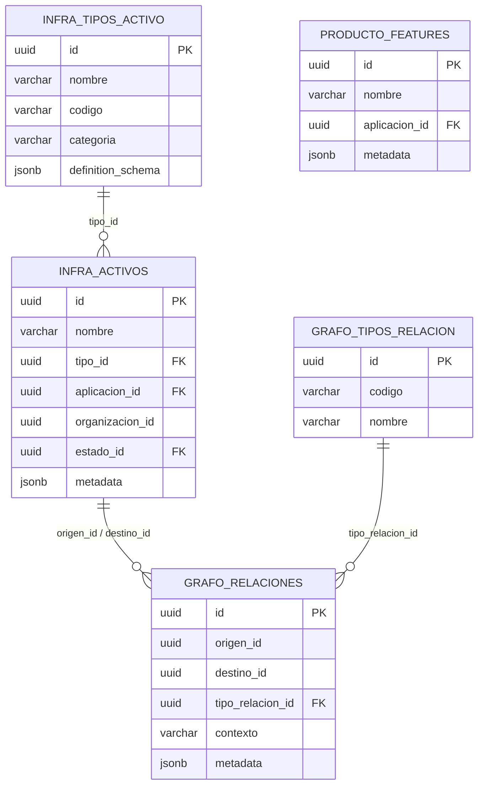
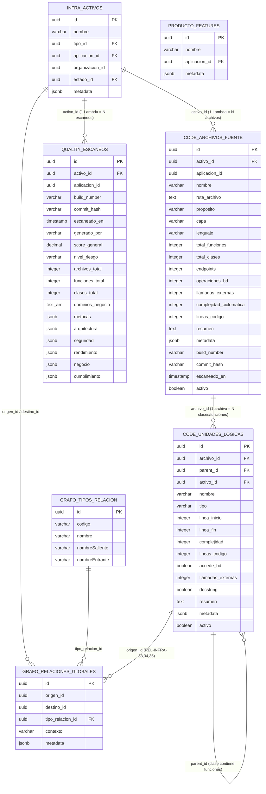

# 🏛️ Propuesta de Arquitectura de Datos — Code-Agent V1.0

> **Documento de planificación** para validación con equipo técnico y DBA.
> No incluye implementación — solo diseño, justificación y DDL propuesto.

---

## 1. Resumen Ejecutivo

### ¿Qué necesitamos?

La iniciativa **Code-Agent V1.0** (Agente Inteligente para Mapeo de Arquitectura Técnica) va a escanear repositorios de Bitbucket y producir:

1. **Inventario de código**: Archivos, clases, funciones, endpoints, operaciones de BD — por cada microservicio
2. **Diagnóstico de calidad**: Score general, nivel de riesgo, métricas de complejidad, análisis OWASP, compliance
3. **Relaciones**: Qué función invoca a cuál, qué clase accede a qué recurso AWS

### ¿Dónde guardar esto?

Se evaluaron 4 opciones. Se recomienda **Opción B: dos tablas nuevas** en schemas dedicados, vinculadas al inventario existente de `infra.activos` via FK lógicas y al grafo existente via UUIDs.

### Relación entre tablas

> **Importante:** La relación entre `infra.activos` y las tablas de código es **1 : muchos**.
> Un Lambda en `infra.activos` genera **muchos** registros en `code.archivos_fuente` (uno por archivo), y cada archivo genera **muchos** registros en `code.unidades_logicas` (uno por clase/función). Ejemplo: `configuration-service` = 1 activo → 131 archivos → ~1,262 unidades lógicas.

### Alcance Fase 1 (Escaneo estático)

> En la Fase 1, el escaneo se realizará **una sola vez** como carga inicial. No habrá re-escaneos automáticos al cambiar el código en producción. La capacidad de re-escaneo se implementará en fases futuras. Sin embargo, el diseño de las tablas ya soporta múltiples escaneos sin necesidad de cambios estructurales.

### Documentos de referencia

| # | Documento | Contenido |
|---|---|---|
| Doc 1 | INI: Code-Agent V1.0 | Visión, objetivos SMART, NFRs |
| Doc 2 | Diagnóstico de Calidad | Métricas, reglas, umbrales |
| Doc 3 | Estructura de BD para Auditoría | Propuesta original de tabla `quality_audits` |
| Doc 4 | PDF Confluence Build #169 | Ejemplo real: 131 archivos, 1,262 funciones del `configuration-service` |

---

## 2. Arquitectura Actual (Lo que ya existe)



**Datos actuales:**
- `infra.activos`: ~413 registros (Lambdas, APIs, S3, SQS, DynamoDB, etc.)
- `infra.tipos_activo`: ~25 tipos con schemas dinámicos
- `grafo.relaciones_globales`: ~200 vínculos
- `producto.features`: ~50 funcionalidades de negocio

---

## 3. Arquitectura Propuesta (Extensión)

### Diagrama General — Modelo ER con columnas



### Relaciones en el grafo

| Código | Tipo | Origen → Destino | Ejemplo |
|--------|------|-------------------|---------|
| `REL-INFRA-05` ✅ | Composición | `infra.activos` → `code.archivos_fuente` | Lambda CONTIENE archivo |
| `REL-INFRA-33` 🆕 | Invocación | `code.unidades_logicas` → `code.unidades_logicas` | función INVOCA función |
| `REL-INFRA-34` 🆕 | Acceso | `code.unidades_logicas` → `infra.activos` | función ACCEDE recurso AWS |
| `REL-INFRA-35` 🆕 | Implementación | `code.unidades_logicas` → `producto.features` | función IMPLEMENTA regla |

### ¿Por qué NO reusar `infra.activos` para las unidades lógicas?

| Problema | Explicación |
|---|---|
| **Volumen** | Solo `configuration-service` produce 131 archivos y ~1,262 funciones. Mezclar con los 413 activos reales sería inmanejable |
| **Ciclo de vida** | Los activos son manuales y estables. Los archivos/funciones se regeneran automáticamente cada escaneo (DELETE masivo + INSERT masivo) |
| **Columnas** | `estado_id` y `organizacion_id` no aplican a un archivo `.java`. Habría NULLs forzados |
| **UI** | El MaestroInfraestructura mostraría miles de archivos Java mezclados con Lambdas reales |

---

## 4. DDL Propuesto y Diccionario de Campos

### 4.1 Tabla `code.archivos_fuente` (Unidades Físicas)

**Propósito:** Inventario de archivos del repositorio. Cada registro = **1 archivo** del repositorio del microservicio.

#### DDL

```sql
CREATE SCHEMA IF NOT EXISTS code;

CREATE TABLE code.archivos_fuente (
    id                      UUID PRIMARY KEY DEFAULT gen_random_uuid(),
    activo_id               UUID NOT NULL,
    aplicacion_id           UUID,
    nombre                  VARCHAR(255) NOT NULL,
    ruta_archivo            TEXT,
    proposito               VARCHAR(30),
    capa                    VARCHAR(20),
    lenguaje                VARCHAR(20),
    total_funciones         INTEGER DEFAULT 0,
    total_clases            INTEGER DEFAULT 0,
    endpoints               INTEGER DEFAULT 0,
    operaciones_bd          INTEGER DEFAULT 0,
    llamadas_externas       INTEGER DEFAULT 0,
    complejidad_ciclomatica INTEGER,
    lineas_codigo           INTEGER,
    resumen                 TEXT,
    metadata                JSONB DEFAULT '{}',
    build_number            VARCHAR(20),
    commit_hash             VARCHAR(40),
    escaneado_en            TIMESTAMP DEFAULT NOW(),
    activo                  BOOLEAN DEFAULT TRUE
);
```

#### Diccionario de columnas (21 columnas)

| # | Columna | Tipo SQL | Null | Descripción | Ejemplo (Build #169) |
|---|---------|----------|------|-------------|----------------------|
| 1 | `id` | `UUID` | No | PK auto-generada | `arch-001` |
| 2 | `activo_id` | `UUID` | No | FK lógica → `infra.activos.id` | ID de `configuration-service` |
| 3 | `aplicacion_id` | `UUID` | Sí | Heredado del padre (filtros rápidos) | ID del Orquestador |
| 4 | `nombre` | `VARCHAR(255)` | No | Nombre del archivo sin extensión | `PayFacController` |
| 5 | `ruta_archivo` | `TEXT` | Sí | Ruta relativa en el repositorio | `./src/.../PayFacController.java` |
| 6 | `proposito` | `VARCHAR(30)` | Sí | Rol funcional detectado por AST | `Controller` |
| 7 | `capa` | `VARCHAR(20)` | Sí | Capa arquitectónica | `Adaptador` |
| 8 | `lenguaje` | `VARCHAR(20)` | Sí | Lenguaje de programación | `Java` |
| 9 | `total_funciones` | `INTEGER` | def 0 | Funciones/métodos en este archivo | `45` |
| 10 | `total_clases` | `INTEGER` | def 0 | Clases en este archivo | `1` |
| 11 | `endpoints` | `INTEGER` | def 0 | Endpoints HTTP | `4` |
| 12 | `operaciones_bd` | `INTEGER` | def 0 | Operaciones de BD | `7` |
| 13 | `llamadas_externas` | `INTEGER` | def 0 | Invocaciones externas | `0` |
| 14 | `complejidad_ciclomatica` | `INTEGER` | Sí | Complejidad total del archivo | `23` |
| 15 | `lineas_codigo` | `INTEGER` | Sí | LOC (sin comentarios) | `350` |
| 16 | `resumen` | `TEXT` | Sí | Descripción generada por LLM | `"Gestiona CRUD de PayFac..."` |
| 17 | `metadata` | `JSONB` | def `{}` | Extensible (vacío en Fase 1) | `{}` |
| 18 | `build_number` | `VARCHAR(20)` | Sí | Build que descubrió este archivo | `#169` |
| 19 | `commit_hash` | `VARCHAR(40)` | Sí | Hash del commit escaneado | `33f9198f` |
| 20 | `escaneado_en` | `TIMESTAMP` | def NOW | Fecha/hora del escaneo | `2025-10-29T16:49:00` |
| 21 | `activo` | `BOOLEAN` | def true | Soft delete | `true` |

#### Valores permitidos

**`proposito`:** `Controller` · `Data Access` · `Utility` · `Service` · `Entity` · `Config`

**`capa`:** `Adaptador` · `Dominio` · [Infraestructura](file:///c:/Users/jcueva/OneDrive%20-%20BIZLINKS%20SAC/Escritorio/Front%20Activos%20tecnolog%C3%ADa/CORE%20PRINCIPAL%201/alignetone-admin-core/src/features/configuration/tecnologia/infraestructura/MaestroInfraestructura.jsx#60-578)

**`lenguaje`:** `Java` · `Python` · `Node.js`

#### Índices (8)

```sql
CREATE INDEX idx_af_activo      ON code.archivos_fuente(activo_id);
CREATE INDEX idx_af_app         ON code.archivos_fuente(aplicacion_id);
CREATE INDEX idx_af_capa        ON code.archivos_fuente(capa);
CREATE INDEX idx_af_proposito   ON code.archivos_fuente(proposito);
CREATE INDEX idx_af_lenguaje    ON code.archivos_fuente(lenguaje);
CREATE INDEX idx_af_complejidad ON code.archivos_fuente(complejidad_ciclomatica DESC);
CREATE INDEX idx_af_loc         ON code.archivos_fuente(lineas_codigo DESC);
CREATE INDEX idx_af_metadata    ON code.archivos_fuente USING GIN (metadata);
```

---

### 4.2 Tabla `code.unidades_logicas` (Clases, Funciones, Interfaces)

**Propósito:** Almacenar las unidades lógicas (clases, funciones, interfaces) descubiertas dentro de cada archivo. Cada registro = **1 clase o 1 función**. Relación jerárquica con `parent_id` autoreferencial.

#### DDL

```sql
CREATE TABLE code.unidades_logicas (
    id                      UUID PRIMARY KEY DEFAULT gen_random_uuid(),
    archivo_id              UUID NOT NULL,
    parent_id               UUID,
    activo_id               UUID NOT NULL,
    nombre                  VARCHAR(255) NOT NULL,
    tipo                    VARCHAR(20) NOT NULL,
    linea_inicio            INTEGER,
    linea_fin               INTEGER,
    complejidad             INTEGER,
    lineas_codigo           INTEGER,
    accede_bd               BOOLEAN DEFAULT FALSE,
    llamadas_externas       INTEGER DEFAULT 0,
    docstring               BOOLEAN DEFAULT FALSE,
    resumen                 TEXT,
    metadata                JSONB DEFAULT '{}',
    activo                  BOOLEAN DEFAULT TRUE
);
```

#### Diccionario de columnas (16 columnas)

| # | Columna | Tipo SQL | Null | Descripción | Ejemplo |
|---|---------|----------|------|-------------|---------|
| 1 | `id` | `UUID` | No | PK auto-generada — referenciable en el grafo | `ul-002` |
| 2 | `archivo_id` | `UUID` | No | FK lógica → `code.archivos_fuente.id` | ID de `PayFacController.java` |
| 3 | `parent_id` | `UUID` | Sí | FK autoreferencial → `code.unidades_logicas.id`. `null` = raíz (clase). Con valor = hijo (función de una clase) | `ul-001` (la clase padre) |
| 4 | `activo_id` | `UUID` | No | FK lógica → `infra.activos.id` (desnormalizado, facilita queries) | ID de `configuration-service` |
| 5 | `nombre` | `VARCHAR(255)` | No | Nombre de la clase/función | `createPayFac` |
| 6 | `tipo` | `VARCHAR(20)` | No | Tipo de unidad lógica (ver abajo) | `FUNCION` |
| 7 | `linea_inicio` | `INTEGER` | Sí | Línea donde comienza | `82` |
| 8 | `linea_fin` | `INTEGER` | Sí | Línea donde termina | `127` |
| 9 | `complejidad` | `INTEGER` | Sí | Complejidad ciclomática individual | `8` |
| 10 | `lineas_codigo` | `INTEGER` | Sí | LOC de esta unidad | `45` |
| 11 | `accede_bd` | `BOOLEAN` | def false | ¿Tiene llamadas a BD? | `true` |
| 12 | `llamadas_externas` | `INTEGER` | def 0 | Invocaciones a servicios externos | `0` |
| 13 | `docstring` | `BOOLEAN` | def false | ¿Tiene documentación `/** */`? | `false` |
| 14 | `resumen` | `TEXT` | Sí | Descripción generada por LLM | `"Crea un nuevo PayFac..."` |
| 15 | `metadata` | `JSONB` | def `{}` | Extensible | `{}` |
| 16 | `activo` | `BOOLEAN` | def true | Soft delete | `true` |

#### Valores permitidos para `tipo`

| Valor | Descripción | `parent_id` |
|-------|-------------|-------------|
| `CLASE` | Clase Java, Python class | `null` (raíz) |
| `FUNCION` | Método o función | UUID de la clase padre |
| `INTERFAZ` | Contrato Java interface | `null` (raíz) |
| `ENUM` | Enumeración | `null` (raíz) |
| `MODULO` | Módulo Node.js exports | `null` (raíz) |

#### Jerarquía con `parent_id`

```
PayFacController.java (ARCHIVO en code.archivos_fuente)
│
├── PayFacController (CLASE, parent_id = null)
│   ├── createPayFac (FUNCION, parent_id = uuid-clase)
│   ├── updatePayFac (FUNCION, parent_id = uuid-clase)
│   └── validateRequest (FUNCION, parent_id = uuid-clase)
│
└── PayFacValidator (CLASE, parent_id = null)
    └── isValid (FUNCION, parent_id = uuid-clase-2)
```

#### Índices (7)

```sql
CREATE INDEX idx_ul_archivo    ON code.unidades_logicas(archivo_id);
CREATE INDEX idx_ul_parent     ON code.unidades_logicas(parent_id);
CREATE INDEX idx_ul_activo     ON code.unidades_logicas(activo_id);
CREATE INDEX idx_ul_tipo       ON code.unidades_logicas(tipo);
CREATE INDEX idx_ul_complejidad ON code.unidades_logicas(complejidad DESC);
CREATE INDEX idx_ul_accede_bd  ON code.unidades_logicas(accede_bd) WHERE accede_bd = true;
CREATE INDEX idx_ul_metadata   ON code.unidades_logicas USING GIN (metadata);
```

---

### 4.3 Tabla `quality.escaneos` (Diagnósticos de Calidad)

**Propósito:** Snapshots de auditoría. Cada registro = **1 escaneo** de un microservicio. INSERT-only (historial inmutable).

#### DDL

```sql
CREATE SCHEMA IF NOT EXISTS quality;

CREATE TABLE quality.escaneos (
    id                  UUID PRIMARY KEY DEFAULT gen_random_uuid(),
    activo_id           UUID NOT NULL,
    aplicacion_id       UUID,
    build_number        VARCHAR(20),
    commit_hash         VARCHAR(40),
    escaneado_en        TIMESTAMP DEFAULT NOW(),
    generado_por        VARCHAR(100),
    score_general       DECIMAL(5,2),
    nivel_riesgo        VARCHAR(10) NOT NULL CHECK (nivel_riesgo IN ('LOW','MEDIUM','HIGH')),
    archivos_total      INTEGER DEFAULT 0,
    funciones_total     INTEGER DEFAULT 0,
    clases_total        INTEGER DEFAULT 0,
    dominios_negocio    TEXT[],
    metricas            JSONB DEFAULT '{}',
    arquitectura        JSONB DEFAULT '{}',
    seguridad           JSONB DEFAULT '{}',
    rendimiento         JSONB DEFAULT '{}',
    negocio             JSONB DEFAULT '{}',
    cumplimiento        JSONB DEFAULT '{}'
);
```

#### Diccionario de columnas fijas (13 columnas)

| # | Columna | Tipo SQL | Null | Descripción | Ejemplo |
|---|---------|----------|------|-------------|---------|
| 1 | `id` | `UUID` | No | PK auto-generada | `660e8400-...` |
| 2 | `activo_id` | `UUID` | No | FK lógica → `infra.activos` | ID de `configuration-service` |
| 3 | `aplicacion_id` | `UUID` | Sí | Heredado del padre | ID del Orquestador |
| 4 | `build_number` | `VARCHAR(20)` | Sí | Build escaneo | `#169` |
| 5 | `commit_hash` | `VARCHAR(40)` | Sí | Commit analizado | `33f9198f` |
| 6 | `escaneado_en` | `TIMESTAMP` | def NOW | Fecha del escaneo | `2025-10-29T16:49:00` |
| 7 | `generado_por` | `VARCHAR(100)` | Sí | Quién generó | `code-agent-v1` |
| 8 | `score_general` | `DECIMAL(5,2)` | Sí | Score 0-100 | `45.50` |
| 9 | `nivel_riesgo` | `VARCHAR(10)` | No | `LOW` · `MEDIUM` · `HIGH` | `HIGH` |
| 10 | `archivos_total` | `INTEGER` | def 0 | Archivos escaneados | `131` |
| 11 | `funciones_total` | `INTEGER` | def 0 | Funciones descubiertas | `1262` |
| 12 | `clases_total` | `INTEGER` | def 0 | Clases descubiertas | `137` |
| 13 | `dominios_negocio` | `TEXT[]` | Sí | Dominios detectados | `{data_access, utility}` |

#### 6 columnas JSONB — Esquemas detallados

##### `metricas`

```json
{ "loc_total": 12500, "complejidad_promedio": 8.5, "complejidad_maxima": 45,
  "archivo_mas_complejo": "PayFacController.java", "total_endpoints": 7,
  "total_operaciones_bd": 14, "porcentaje_documentacion": 25.2,
  "lenguajes": { "Java": 131, "XML": 3 } }
```

##### `arquitectura`

```json
{ "patron": "Monolito modular", "cohesion": "Baja", "acoplamiento": "Alto",
  "dip": "No cumple", "separacion_capas": "Parcial",
  "distribucion_capas": { "Adaptador": {"total":3}, "Dominio": {"total":15}, "Infraestructura": {"total":113} },
  "hallazgos": ["Controladores contienen lógica de negocio (violación SRP)"] }
```

##### `seguridad`

```json
{ "owasp": [
    { "categoria": "A03:2021 Injection", "hallazgo": "Queries sin sanitización", "severidad": "HIGH" },
    { "categoria": "A07:2021 Auth Failures", "hallazgo": "No valida JWT", "severidad": "MEDIUM" }
  ], "compliance_pci_dss": false, "riesgos_criticos": 1, "riesgos_medios": 3 }
```

##### `rendimiento`

```json
{ "cuellos_botella": ["Query N+1 en CommerceController.java"],
  "caching": false, "n_plus_1": true, "cold_start_risk": "MEDIUM" }
```

##### `negocio`

```json
{ "summary": "Gestiona configuración de comercios 3DS",
  "purpose": "Centralizar CRUD de PayFacs y Acquirers",
  "owner_team": "Equipo Core Pagos", "data_sensitivity": "HIGH PCI-DSS",
  "reglas": [
    { "descripcion": "Clave de comercio única por acquirer", "archivo": "InsertConfigurationCommerce.java", "funcion": "validateCommerceKey", "linea": 733 }
  ] }
```

##### `cumplimiento`

```json
{ "loc_ok": false, "complexity_ok": false, "has_multi_layer_coupling": true,
  "naming_ok": true, "tests_ok": false, "docs_ok": false,
  "detalle": { "funciones_con_loc_mayor_30": 12, "archivos_sin_tests": 131 } }
```

#### Índices (7)

```sql
CREATE INDEX idx_esc_activo   ON quality.escaneos(activo_id);
CREATE INDEX idx_esc_fecha    ON quality.escaneos(escaneado_en DESC);
CREATE INDEX idx_esc_riesgo   ON quality.escaneos(nivel_riesgo);
CREATE INDEX idx_esc_score    ON quality.escaneos(score_general);
CREATE INDEX idx_esc_app      ON quality.escaneos(aplicacion_id);
CREATE INDEX idx_esc_seg_gin  ON quality.escaneos USING GIN (seguridad);
CREATE INDEX idx_esc_met_gin  ON quality.escaneos USING GIN (metricas);
```

---

---

### 4.4 Tipos de Relación para el Grafo
Se sigue la convención existente `REL-INFRA-XX`. Los 31 tipos actuales llegan hasta `REL-INFRA-32`.

#### Tipo existente que se REUTILIZA

| Código | Nombre | Saliente | Entrante | Estado |
|--------|--------|----------|----------|--------|
| `REL-INFRA-05` | Composición | "Contiene a" | "Es componente de" | ✅ **Ya existe** — se reutiliza para: Lambda CONTIENE archivo |

> `REL-INFRA-05` ya tiene la semántica exacta que necesitamos: un activo padre "contiene" a un componente hijo. Se usa directamente sin modificación.

#### Tipos NUEVOS a crear (INSERT en `grafo.tipos_relacion`)

```sql
INSERT INTO grafo.tipos_relacion (id, codigo, nombre, "nombreSaliente", "nombreEntrante", categoria, esquema, description, metadata) VALUES

-- REL-INFRA-33: Invocación entre unidades lógicas (función llama a función)
(gen_random_uuid(), 'REL-INFRA-33', 'Invocación de Código',
 'Invoca a', 'Es invocado por',
 'INFRAESTRUCTURA', 'MAESTRO',
 'Una unidad lógica (función/clase) invoca a otra unidad lógica dentro del mismo o diferente microservicio',
 '{"dominio": "code-intelligence", "generado_por": "code-agent", "contextos_sugeridos": ["Invocación directa", "Delegación", "Callback"]}'::jsonb),

-- REL-INFRA-34: Acceso a recurso AWS (unidad lógica accede a S3, DynamoDB, SQS, etc.)
(gen_random_uuid(), 'REL-INFRA-34', 'Acceso a Recurso desde Código',
 'Accede al recurso', 'Es accedido por código en',
 'INFRAESTRUCTURA', 'MAESTRO',
 'Unidad lógica (archivo/función) accede a un recurso AWS (S3, DynamoDB, SQS, Secrets Manager)',
 '{"dominio": "code-intelligence", "generado_por": "code-agent", "contextos_sugeridos": ["Read/Write", "Read-Only", "Write-Only", "Subscribe"]}'::jsonb),

-- REL-INFRA-35: Implementación de regla de negocio
(gen_random_uuid(), 'REL-INFRA-35', 'Implementación de Regla',
 'Implementa la regla', 'Es implementada por',
 'INFRAESTRUCTURA', 'MAESTRO',
 'Una función implementa una regla de negocio registrada en producto.features',
 '{"dominio": "code-intelligence", "generado_por": "code-agent", "contextos_sugeridos": ["Validación", "Cálculo", "Flujo de proceso", "Transformación"]}'::jsonb);
```

#### Resumen de relaciones Code-Agent

| Código | Nombre | Origen → Destino | Ejemplo |
|--------|--------|-------------------|---------|
| `REL-INFRA-05` ✅ | Composición | `infra.activos` → `code.archivos_fuente` | `configuration-service` CONTIENE `PayFacController.java` |
| `REL-INFRA-33` 🆕 | Invocación de Código | `code.unidades_logicas` → `code.unidades_logicas` | `createPayFac()` INVOCA `insertConfiguration()` |
| `REL-INFRA-34` 🆕 | Acceso a Recurso desde Código | `code.unidades_logicas` → `infra.activos` | `DataBaseCredentials` ACCEDE a `MongoDB Atlas` |
| `REL-INFRA-35` 🆕 | Implementación de Regla | `code.unidades_logicas` → `producto.features` | `validateCommerceKey()` IMPLEMENTA "Clave única por acquirer" |

---

## 5. Flujo de Datos

### Fase 1: Carga Inicial (escaneo estático, una sola vez)

```
Code-Agent escanea "configuration-service" (Build #169) — CARGA ÚNICA
    │
    ├─ 1. Busca el activo en infra.activos WHERE nombre LIKE 'configuration-service'
    │     → Obtiene activo_id = "abc-123"
    │
    ├─ 2. Inserta 131 archivos fuente
    │     INSERT INTO code.archivos_fuente (activo_id, nombre, ruta_archivo, ...)
    │     VALUES ('abc-123', 'PayFacController', './src/.../PayFacController.java', ...)
    │     ... × 131 registros
    │
    ├─ 3. Inserta unidades lógicas (clases y funciones) por cada archivo
    │     INSERT INTO code.unidades_logicas (archivo_id, nombre, tipo, ...)
    │     VALUES ('<uuid-PayFac>', 'PayFacController', 'CLASE', ...)
    │     VALUES ('<uuid-clase>', 'createPayFac', 'FUNCION', ...)
    │     ... × ~1,262 registros
    │
    ├─ 4. Crea relaciones en el grafo
    │     INSERT INTO grafo.relaciones_globales
    │     (origen = 'abc-123', destino = '<uuid-archivo>', tipo = 'REL-INFRA-05')
    │     ... × 131 (Composición: activo CONTIENE archivo)
    │
    └─ 5. Inserta UN snapshot de auditoría
          INSERT INTO quality.escaneos
          (activo_id = 'abc-123', score_general = 45, nivel_riesgo = 'HIGH', ...)
          → Solo 1 registro por Lambda en Fase 1
```

### Fase Futura: Re-escaneo (cuando se implemente)

```
Code-Agent detecta cambio en "configuration-service" (Build #185)
    │
    ├─ 1. Limpia archivos y unidades anteriores
    │     DELETE FROM code.unidades_logicas WHERE activo_id = 'abc-123'
    │     DELETE FROM code.archivos_fuente WHERE activo_id = 'abc-123'
    │
    ├─ 2. Inserta archivos y unidades actualizados (INSERT masivo)
    │
    ├─ 3. Actualiza relaciones en el grafo
    │
    └─ 4. Inserta NUEVO snapshot de auditoría (INSERT-only)
          → Se acumula historial: scan #169 vs scan #185
```

---

## 6. Queries que el Sistema Soportaría

### Queries operativos

```sql
-- ¿Qué archivos tiene el configuration-service?
SELECT nombre, proposito, capa, complejidad_ciclomatica, lineas_codigo
FROM code.archivos_fuente
WHERE activo_id = 'abc-123'
ORDER BY complejidad_ciclomatica DESC;

-- ¿Qué funciones acceden a la BD en este microservicio?
SELECT ul.nombre, af.nombre AS archivo, ul.linea_inicio, ul.complejidad
FROM code.unidades_logicas ul
JOIN code.archivos_fuente af ON af.id = ul.archivo_id
WHERE ul.activo_id = 'abc-123'
  AND ul.tipo = 'FUNCION'
  AND ul.accede_bd = true;

-- Top 10 funciones más complejas del Orquestador
SELECT ul.nombre, ul.complejidad, af.nombre AS archivo, a.nombre AS lambda
FROM code.unidades_logicas ul
JOIN code.archivos_fuente af ON af.id = ul.archivo_id
JOIN infra.activos a ON a.id = ul.activo_id
WHERE ul.activo_id IN (SELECT id FROM infra.activos WHERE aplicacion_id = '<orquestador-id>')
  AND ul.tipo = 'FUNCION'
ORDER BY ul.complejidad DESC
LIMIT 10;
```

### Queries de auditoría (evolución temporal)

```sql
-- Evolución de score del configuration-service
SELECT build_number, escaneado_en, score_general, nivel_riesgo
FROM quality.escaneos
WHERE activo_id = 'abc-123'
ORDER BY escaneado_en;

-- ¿Qué Lambdas son HIGH risk en el último escaneo?
SELECT DISTINCT ON (e.activo_id) a.nombre, e.score_general, e.nivel_riesgo, e.escaneado_en
FROM quality.escaneos e
JOIN infra.activos a ON a.id = e.activo_id
ORDER BY e.activo_id, e.escaneado_en DESC;

-- ¿Cuántos hallazgos de seguridad tiene cada aplicación?
SELECT app.nombre,
       COUNT(*) AS total_escaneos,
       AVG(e.score_general) AS score_promedio
FROM quality.escaneos e
JOIN infra.activos a ON a.id = e.activo_id
JOIN producto.aplicaciones app ON app.id = e.aplicacion_id
GROUP BY app.nombre
ORDER BY score_promedio;
```

---

## 7. Proyección de Volumen

### Relación entre tablas (ejemplo concreto)

| Tabla | Registros para `configuration-service` | Explicación |
|---|---|---|
| `infra.activos` | **1** registro | El componente Lambda real |
| `code.archivos_fuente` | **131** registros | Archivos del repositorio |
| `code.unidades_logicas` | **~1,400** registros | Clases (~137) + funciones (~1,262) |
| `quality.escaneos` | **1** registro (Fase 1) | Un snapshot de auditoría por escaneo |
| `grafo.relaciones_globales` | **~131** registros | Una relación `CONTIENE` por archivo |

### Proyección total por fase

| Tabla | Fase 1 (5 apps, 1 escaneo) | Fase Futura (15 apps, re-escaneos) |
|---|---|---|
| `infra.activos` | ~413 **(sin cambio)** | ~600 |
| `code.archivos_fuente` | ~500-1,000 | ~3,000+ |
| `code.unidades_logicas` | ~5,000-10,000 | ~30,000+ |
| `quality.escaneos` | ~30-50 | ~300+ |
| `grafo.relaciones_globales` | ~700 | ~4,000+ |

> [!NOTE]
> **Fase 1 es estática.** Incluso con 30,000 unidades lógicas, PostgreSQL maneja queries en <100ms con los índices propuestos.

---

## 8. Integración con Admin Core (Frontend)

### Vista existente (sin cambios)

| Vista | Tabla | Cambios |
|---|---|---|
| MaestroInfraestructura | `infra.activos` | ❌ Ninguno — sigue mostrando solo componentes reales |
| MaestroTiposActivo | `infra.tipos_activo` | ❌ Ninguno |
| MaestroAplicaciones | `producto.features` | ❌ Ninguno |

### Vistas nuevas (futuro)

| Vista Propuesta | Tabla | Propósito |
|---|---|---|
| **Code Explorer** | `code.archivos_fuente` + `code.unidades_logicas` | Explorar archivos, clases y funciones por Lambda/aplicación |
| **Quality Dashboard** | `quality.escaneos` | Ver score, riesgo, evolución temporal por Lambda/aplicación |
| **Dependency Graph** | `grafo.relaciones_globales` | Visualizar relaciones de código (invocaciones, accesos a BD) |

> [!TIP]
> Estas vistas quedarían como nuevas pestañas en la sección "Activos de Tecnología", junto a las 3 pestañas existentes (Componentes, Aplicaciones, Maestro de Infraestructura).

---

## 9. Preguntas para DBA / Equipo Backend

1. **¿Los schemas `code` y `quality` se crean en la misma BD de A-ONE o en BD separada?**
   - Recomendación: Misma BD, schemas separados (aislamiento lógico sin complejidad operativa).

2. **¿FK enforced o lógica entre `code.unidades_logicas.activo_id` → `infra.activos.id`?**
   - El backend genérico actual no maneja FK cross-schema.
   - Recomendación: FK lógica validada por el Code-Agent al momento de escritura.

3. **¿Se exponen las tablas nuevas vía el mismo backend genérico (`/entities/unidades_logicas`)?**
   - Si sí: zero desarrollo backend, pero sin validaciones custom.
   - Si no: se necesita un endpoint dedicado con validaciones.

4. **¿Política de retención para `quality.escaneos`?**
   - ¿Guardar todos los escaneos para siempre?
   - ¿O borrar escaneos mayores a 12 meses?

5. **¿Permisos de escritura?**
   - Solo el Code-Agent (service account) debería escribir en `code.*` y `quality.*`.
   - Los usuarios del Admin Core solo necesitan lectura.

---

## 10. Documentación asociada

| Documento | Contenido |
|---|---|
| **Este documento** (Propuesta de Arquitectura) | Diseño de tablas, DDL, flujo de datos, queries |
| **CODE_AGENT_DATA_MODEL_v1.md** | Diccionario de campos detallado, esquemas JSONB con ejemplos reales, valores permitidos |
| **TEMPLATE_DOCUMENTO_ANALISIS_v4.md** | Template de salida que el Code-Agent genera por cada microservicio escaneado |

---

## 11. Resumen de la Propuesta

| Elemento | Acción | Responsable |
|---|---|---|
| Schema `code` + tabla `archivos_fuente` (21 cols + 8 índices) | **CREAR** | DBA |
| Schema `code` + tabla `unidades_logicas` (16 cols + 7 índices) | **CREAR** | DBA |
| Schema `quality` + tabla `escaneos` (13 cols + 6 JSONB + 7 índices) | **CREAR** | DBA |
| `REL-INFRA-05` (Composición) | **REUTILIZAR** (ya existe) | — |
| `REL-INFRA-33`, `34`, `35` | **INSERT** (3 registros nuevos) | DBA o Backend |
| Endpoints en backend genérico | **Configurar** | Backend |
| Vistas en Admin Core (Code Explorer, Dashboard) | **Desarrollar** (Fase 2) | Frontend |
| Lógica de escritura del Code-Agent | **Desarrollar** | Equipo Code-Agent |
| `infra.activos` | **SIN CAMBIOS** | — |
| `infra.tipos_activo` | **SIN CAMBIOS** | — |
| `grafo.relaciones_globales` | **SIN CAMBIOS** (solo nuevas relaciones) | — |
